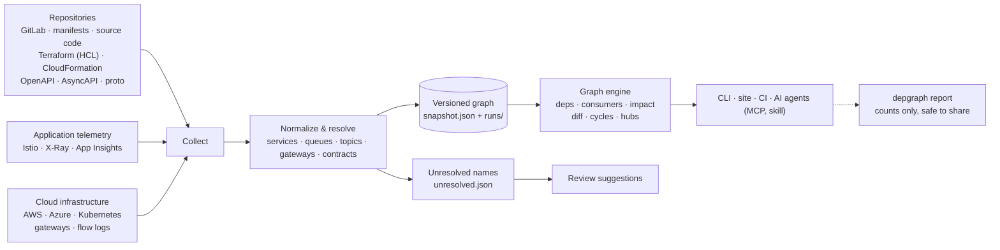

<div align="center">

# depgraph

**Know what depends on what, before you make the change.**

A self-hosted dependency graph for the services, infrastructure and runtime traffic you already have. Ask it *"what breaks if I change this?"* from the terminal, a merge request, or your coding agent.

[](https://github.com/DennisvDijk/dependency-graph/actions/workflows/ci.yml)
[](rust-toolchain.toml)
[](docs/quickstart.md)
[](schemas/graph.schema.json)

[Try the demo](#try-it-in-two-minutes) · [Ask the graph](#ask-the-graph) · [Use it from CI and agents](#use-it-from-ci-and-coding-agents) · [Run it on your estate](#run-it-on-your-estate) · [Docs](#documentation)

</div>

---

## Why

A change rarely stops at one repository. Services call services, deployments move between environments, firewall rules allow paths nobody uses. The answers sit in different tools, so a simple question stays hard: **what could this change affect, and who should hear about it?**

depgraph reads what you already have (repositories, manifests, Terraform, cloud accounts, telemetry), merges it into one graph, and keeps the **evidence** for every tie. It needs no catalog file per service, and it runs where you run it: your GitLab behind a firewall is the intended home.

- **Find** services, queues, topics, databases, gateways, contracts and the ties between them.
- **Judge** impact, consumers, deploy order, cycles and drift between declared and observed.
- **Trust carefully.** Every edge says whether it was declared, observed, inferred or seen as traffic. An empty answer can mean the graph does not see it, and the tool tells you so.
- **Fit your workflow** through the CLI, merge-request notes, a generated site, and a read-only MCP server and skill for AI coding agents.

## Try it in two minutes

The demo uses bundled sample repositories and recorded metrics, runs in a temporary folder, and touches no account.

```bash
git clone https://github.com/DennisvDijk/dependency-graph.git
cd dependency-graph
cargo install --path . --locked
scripts/demo.sh
```

You need Rust via [rustup](https://rustup.rs) (the repo pins **1.100.0**), Bash and Python 3. The walkthrough is in [docs/tutorials/01-try-it.md](docs/tutorials/01-try-it.md). Actual output from the demo:

```text
$ depgraph impact billing-api --env prod
depth  path_score  id                        owner        basis      via
1      0.463       component:payments-api    ai-platform  confirmed  component:billing-api <- component:payments-api (declared_depends_on, both)
owners to tell: ai-platform

$ depgraph drift --env prod
## both            payments-api -> billing-api            calls_7d=100
## observed_only   payments-api -> api-stripe-com         calls_7d=8
## declared_only   payments-api -> payments-db
```

## Ask the graph

| Question | Command |
|---|---|
| What is this, who owns it, how sure are we? | `depgraph show payments-api` |
| What does it use? Who uses it? | `depgraph deps payments-api --env prod` · `depgraph consumers billing-api --env prod` |
| What breaks if I change it, and who do I tell? | `depgraph impact billing-api --env prod` |
| In what order do I deploy? | `depgraph deploy-order` |
| Where do declared and observed disagree? | `depgraph drift --env prod` |
| What changed since last run? | `depgraph diff` (the two newest runs) · `depgraph diff --from previous` |
| What did the graph look like then? | `depgraph runs` · `depgraph at --date 2026-01-10T00:00:00Z` |
| Did an API or event change break something? | `depgraph contract-diff --old old.yaml --new new.yaml` |

Read commands accept `--snapshot`, `--env`, `--depth` and `--format table|json|mermaid` where it applies. The names above are the demo's.

**Reading impact.** Each affected node shows *why*: the chain of ties (`via`) and a `basis`. `confirmed` means some route has no guessed tie in it. `inferred` means the node is *potentially affected, not proven*, because every route uses a candidate tie. Scores rank paths by observed call share and a hardness factor; they are **not probabilities**. Nodes with 20 or more neighbours carry a `hub` flag (a shared database, a common library): look at the non-hub paths first. More in [all graph questions](docs/tutorials/03-ask-questions.md).

## How it works



Collectors gather source records. The normalizer resolves them into a snapshot and lists names it could not place. Queries run on that snapshot, so you can inspect the graph without calling every source again, and every build is archived so runs can be compared. Deeper: [how the graph is built](docs/graph-construction.md) (layers, rules, tools) and [architecture and why](docs/architecture.md).

### What it reads, with nothing to configure per service

| Source | What depgraph finds |
|---|---|
| **Catalog files and manifests** | Components, owners, declared `dependsOn`, Kubernetes manifests, network policies, `docker-compose` `depends_on` |
| **Source code** | Python, Elixir, Rust, JavaScript, TypeScript, Go, Java, Kotlin and C#: service URLs, database hosts, literal queue and topic names, and common idioms such as Java `new Hostname("payment")` and Spring `convertAndSend("queue", ...)`. Queues and topics carry impact from publisher to consumer. Computed names (`${var.env}-orders`) are not read; secrets in connection strings are dropped |
| **API and event contracts** | OpenAPI, AsyncAPI and `.proto` files become contract nodes. The repo's component provides the contract; a proto import is a declared use and a call to the provider is a candidate use, so a contract change shows who it reaches. AsyncAPI channels link to topics, so event changes reach consumers. Spec reading is heuristic; fields and types are not compared |
| **Gateways** | Kubernetes `Ingress` and Gateway API `HTTPRoute` become a gateway node with `routes_to` edges. A service whose code calls the gateway's hostname gets a candidate edge to it. With the optional AWS and Azure reads, load balancers, API Gateway, Application Gateway and API Management appear the same way. Terraform and CloudFormation load balancers and service meshes are not read |
| **Firewall rules** | `kind: FirewallRule` YAML, and AWS security groups from Terraform and CloudFormation, linked to the service they are attached to |
| **Terraform and CloudFormation** | Real HCL parsing (a file that fails to parse is listed in `unresolved.json`, never guessed). SQS queues, SNS topics, subscriptions and Lambda event-source mappings become nodes and edges. The image a service runs links it to the component built from it. Local modules and plain-string locals are expanded |
| **Live cloud (opt-in)** | AWS and Azure resources, security groups, load balancers, API gateways, X-Ray and Application Insights calls, existing flow logs. Read-only list and describe calls |
| **Live Kubernetes (opt-in)** | A cluster node and its workloads, read-only; secrets are never read |
| **Application telemetry** | Istio call metrics from Prometheus |

Cloud resource names are matched to your services by loose matching (`prod-orders-py-sg` finds `orders-py`) and an optional alias file. A name that matches nothing is never invented as a service; it goes to `unresolved.json` for review. See [cloud discovery](docs/tutorials/09-cloud-discovery.md) for sources and limits.

### Evidence

| Signal | What it means |
|---|---|
| **Declared** | A repository or catalog says the dependency exists. |
| **Observed call** | Telemetry reported a call. Visibility depends on what you collect. |
| **Candidate** | Configuration or source code suggests a tie; it is not proof of a call. Everything found by reading files is a candidate, never an observation. |
| **Network traffic** | Flow logs saw packets. Packet direction does not show which application called, so these edges never drive impact or drift. |

A missing edge is not proof that a connection does not exist.

## Use it from CI and coding agents

- **Merge requests.** `depgraph mr-check` posts a note on a change: who is affected, whom to ask, and whether an API or event contract change is breaking (removed operations are, added ones are not). It asks for approval when a contract change is breaking (or, when no contract diff is available, when a watched path is touched). See [docs/tutorials/05-mr-check.md](docs/tutorials/05-mr-check.md).
- **Coding agents.** `depgraph skill install` copies the skill ([`skills/analyzing-service-dependencies`](skills/analyzing-service-dependencies/SKILL.md)) to Claude Code, OpenCode, Pi and the shared `.agents/skills` folder. `depgraph serve-mcp --stdio` serves the same answers as MCP tools. Setup per agent, a Claude Code plugin and what has been verified: [docs/agents.md](docs/agents.md). The repo also ships [`AGENTS.md`](AGENTS.md) for agents working on depgraph itself.
- **A shared server.** `depgraph serve-mcp` with token authentication ([MCP authentication](docs/mcp.md)); the container image is in [docs/docker.md](docs/docker.md). For a quick local try: `depgraph serve-mcp --insecure-local --snapshot data/snapshot.json`, then `depgraph mcp-config cursor` (or `claude`, `vscode`, `opencode`). `--insecure-local` only works on loopback.

## Run it on your estate

```bash
depgraph init       # writes starter config if missing; set your GitLab URL in config/config.yaml
depgraph doctor     # checks config, glab, snapshot freshness
depgraph discover   # guided: repositories, optional cloud reads; writes data/snapshot.json
```

Sign in with `glab` or a token in your environment. `discover` shows the scope before it reads. For scripts, choose sources explicitly:

```bash
depgraph discover --repos-only
depgraph discover --aws --azure           # optional cloud reads (existing aws and az logins)
depgraph discover --prometheus --aws      # configured Istio metrics + AWS
depgraph discover --kubernetes            # read-only: current kubectl context
```

Cloud discovery is **opt-in**, read-only, and can incur charges; flow logs and read permissions must already exist. The default scope is the AWS CLI's region and the Azure CLI's subscription. Kubernetes workloads link to a repository component only when an existing label matches one; otherwise they stay visible, unlinked. See [run on real data](docs/tutorials/06-real-data.md) for permissions, formats and gaps.

**On a schedule.** `.gitlab-ci.yml` has the scheduled collector jobs; `depgraph freshness` fails a pipeline when the snapshot is stale. See the [runbook](docs/runbook.md).

**In a container.** [docs/docker.md](docs/docker.md): serve, run commands, health check, timeouts.

**When names don't match.** `depgraph suggest` proposes alias and namespace lines for review. It changes nothing by itself. `depgraph suggest --llm` (after `depgraph model-setup`) uses an OpenAI-compatible endpoint you choose; it is off by default and sends unmatched and known component names to that endpoint. See [troubleshooting](docs/tutorials/07-troubleshooting.md#review-suggestions-for-unresolved-names).

**Working where the maintainers cannot see.** `depgraph report` writes a short Markdown summary of a run: node, edge and evidence counts, which collectors worked, and what *kinds* of names could not be resolved. It contains **counts only**, no repository, host or service names. `--include-names` adds up to 40 unresolved names with secrets removed; `--output report.md` writes a file. Read it before you share it.

## Status and trust

depgraph is ready for a **supervised pilot**, not yet a trusted source of truth. Check edges by hand before anyone relies on them.

- **Accuracy.** CI scores the whole pipeline against two real open-source systems with hand-written truth: Online Boutique and Sock Shop, precision and recall 1.00 on both ([benchmarks](docs/benchmarks.md)). The scanner was tuned on those two, so read that as what it can read, not a forecast for your estate. Small `trap_*` tests guard precision: code that mentions a service without calling it must produce nothing.
- **Secrets.** A test plants fake secrets in Terraform, Python, Compose and Kubernetes files and fails if any reaches an output. It covers those file types, not every collector.
- **MCP server.** Only asymmetric token signatures (RSA, ECDSA, EdDSA); key-set fetches have a cooldown; `--insecure-local` accepts only loopback Host and Origin headers.
- **Supply chain.** `cargo deny` runs on every change. A `v*` tag builds a release signed with cosign (GitLab also signs the container image), with checksums and a dependency list; GitHub adds build provenance ([releases](docs/releases.md)). Neither release pipeline has run on a real tag yet.
- **CI.** GitHub Actions gates this repository. `.gitlab-ci.yml` runs the same checks plus the scheduled collectors, but has not run on a real GitLab runner yet.
- **Not covered.** Network traffic never counts as a dependency; field-level contract changes are not compared; the licence is undecided (below).

## Documentation

| Start here | Go deeper |
|---|---|
| [Try the demo](docs/tutorials/01-try-it.md) | [Run on real data](docs/tutorials/06-real-data.md) |
| [Ask graph questions](docs/tutorials/03-ask-questions.md) | [AWS and Azure discovery](docs/tutorials/09-cloud-discovery.md) |
| [Connect an AI assistant](docs/tutorials/04-ai-agent.md) · [Agents](docs/agents.md) | [Terraform, firewalls and containers](docs/tutorials/08-terraform-python-open-source.md) |
| [Check a merge request](docs/tutorials/05-mr-check.md) | [Architecture](docs/architecture.md) · [How the graph is built](docs/graph-construction.md) · [Naming rules](docs/naming.md) · [Decisions](docs/decisions/) |
| [When something doesn't resolve](docs/tutorials/07-troubleshooting.md) | [Benchmarks](docs/benchmarks.md) |
| [Runbook](docs/runbook.md) · [All tutorials](docs/tutorials/README.md) | [Releases and signatures](docs/releases.md) · [Docker](docs/docker.md) · [MCP authentication](docs/mcp.md) |

## Development

```bash
cargo fmt --check
cargo clippy --all-targets --all-features -- -D warnings
cargo test --all-targets --all-features
cargo deny check
```

Benchmarks have a ratchet in `tests/benchmark.rs`: raise it when the tool improves, never lower it to pass. Golden files: `UPDATE_GOLDEN=1 cargo test --test phase1`.

Collectors read source systems; commands that write merge-request notes, issues or drafts need an explicit invocation. Keep tokens, kubeconfigs and real production data out of the repository.

## Licence

The project is currently **unlicensed** (`UNLICENSED` in `Cargo.toml`); a licence has not been chosen.
