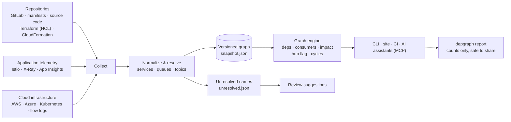

<div align="center">

# depgraph

**Know what depends on what—before you make the change.**

A self-hosted dependency graph for the services, infrastructure and runtime traffic you already have.

[](rust-toolchain.toml)
[](docs/quickstart.md)
[](schemas/graph.schema.json)

[Try the demo](#try-it-without-an-account) · [Discover your estate](#discover-your-estate) · [Ask the graph](#ask-the-graph) · [Documentation](#documentation)

</div>

---

## The problem

A change rarely stops at one repository. Services call services; deployments move between environments; firewall rules allow paths that might never be used. The answers live in different tools, and an incomplete picture makes it harder to answer a simple question: **what could this change affect?**

depgraph brings those signals together in a graph you can inspect, query and share with your team. It works with existing repositories and infrastructure; a catalog file for every service is not required.

| | What you get |
|---|---|
| **Find dependencies** | Explore services, deployments, infrastructure and the ties depgraph can establish. |
| **Understand impact** | Find consumers, transitive impact, deploy order, cycles and drift. |
| **Keep the evidence** | See whether a tie was declared, observed in application telemetry, inferred from configuration or seen as network traffic. |
| **Bring it into your workflow** | Use the CLI, a generated site, merge-request checks or a read-only MCP server for AI assistants. |

## How it works



Collectors gather source records. The normalizer resolves them into a snapshot and records names it couldn't place. Queries work from that snapshot, so the graph can be inspected without calling every source again. Historical snapshots support comparisons over time.

### What it reads, with nothing to configure per service

| Source | What depgraph finds |
|---|---|
| **Catalog files and manifests** | Components, owners, declared `dependsOn`, Kubernetes manifests, network policies, `docker-compose` `depends_on` |
| **Source code** | Python, Elixir, Rust, JavaScript, TypeScript, Go, Java, Kotlin and C#: service URLs, database hosts and literal queue and topic names. Queues and topics carry impact from publisher to consumer. Only literal names are read (computed names such as `${var.env}-orders` are not), and secrets in connection strings are dropped |
| **Gateways** | Kubernetes `Ingress` and Gateway API `HTTPRoute` objects become a gateway node with a `routes_to` edge to each service they forward to. A route to a service depgraph doesn't know goes to `unresolved.json`. A service whose source code calls the gateway's hostname (for example `https://shop.acme-store.io`) gets a candidate edge to the gateway, so a change in a backend shows the gateway and its callers as affected. Wildcard hosts are skipped. With the optional AWS and Azure reads, load balancers, HTTP API Gateway, Application Gateway and API Management show up the same way (`docs/tutorials/09-cloud-discovery.md`). Terraform and CloudFormation load balancers and service meshes are not read |
| **Firewall rules** | `kind: FirewallRule` YAML, and AWS security groups from Terraform and CloudFormation. A group is linked to the service it is attached to |
| **Terraform and CloudFormation** | Terraform is read with a real HCL parser; a file that does not parse is skipped and listed in `unresolved.json`, not guessed at. SQS queues, SNS topics, subscriptions and Lambda event-source mappings become queue and topic nodes with edges. The container image a service runs links it to the component built from that image. Environment settings that name a database add a candidate tie to it. Local Terraform modules and plain-string locals are expanded |
| **Live cloud (opt-in)** | AWS and Azure resources, X-Ray and Application Insights calls, existing flow logs |
| **Live Kubernetes (opt-in)** | A cluster node plus its workloads, read-only; secrets are never read |
| **Application telemetry** | Istio call metrics from Prometheus |

Cloud resource names are matched to services you already have by loose matching (`prod-orders-py-sg` finds `orders-py`) and the optional alias file. A name that matches nothing is never invented as a service; it goes to `unresolved.json` for review.

### Evidence matters

| Signal | What it means |
|---|---|
| **Declared** | A repository or catalog says a dependency exists. |
| **Observed call** | Application telemetry reported a call. Visibility depends on the telemetry you collect. |
| **Candidate** | Configuration or static evidence suggests a possible tie; it is not proof of a call. |
| **Network traffic** | Flow logs saw packets. Packet direction does not prove which application initiated a call, so these edges do not drive impact or drift. |

A missing edge is not proof that a connection doesn't exist. Everything found by reading files is a candidate, never an observation.

### Hubs

Query results show a `links` count (distinct neighbours) and a `hub` flag for nodes with 20 or more. A hub, such as a shared database or a common library, makes an impact list long without telling you much, so look at the non-hub paths first. The flag follows the `--env` filter you pass.

See [cloud discovery](docs/tutorials/09-cloud-discovery.md) for the sources and current limits.

## Try it without an account

The demo uses bundled sample repositories and recorded metrics. It runs in a temporary directory and doesn't access your cloud accounts.

```bash
git clone https://github.com/DennisvDijk/dependency-graph.git
cd dependency-graph
cargo install --path . --locked
scripts/demo.sh
```

You need Rust via [rustup](https://rustup.rs), Bash and Python 3. The repository pins Rust **1.100.0**. The demo prints its temporary folder so you can inspect the graph and generated site. Start with the [five-minute walkthrough](docs/tutorials/01-try-it.md).

## Discover your estate

Start with the access details for your GitLab instance. `init` writes starter files if they don't already exist; set your GitLab URL in `config/config.yaml` and sign in with `glab` or provide a token through your environment.

```bash
depgraph init
depgraph doctor
depgraph discover
```

`discover` guides you through repository and optional cloud reads, shows the scope, and builds `data/snapshot.json` plus `data/unresolved.json`. It can also query a configured Prometheus endpoint for Istio calls. Cloud discovery is **opt-in** and uses the existing `aws` and `az` CLI logins; no per-service cloud mapping is required. Existing flow logs and the necessary read permissions are still required, and cloud queries can incur charges.

For non-interactive use, choose sources explicitly:

```bash
depgraph discover --repos-only
depgraph discover --aws --azure           # optional cloud reads
depgraph discover --prometheus --aws      # configured Istio metrics + AWS
depgraph discover --kubernetes            # read-only: current kubectl context
```

**Kubernetes** discovery (`--kubernetes`) reads the current `kubectl` context with read-only calls and adds a cluster node plus workload nodes (Deployments, StatefulSets and similar). Secrets are never read. A workload is linked to a repository component only when an existing label matches one; otherwise it stays visible, unlinked. Network-traffic edges never count towards dependency or impact analysis.

The default cloud scope is the AWS CLI's selected region and the Azure CLI's selected subscription. AWS flow evidence currently covers supported ECS task interfaces; Azure VNet Traffic Analytics discovers VM-to-VM traffic, not the application responsible on a VM. See [cloud discovery](docs/tutorials/09-cloud-discovery.md) for permissions, supported formats and gaps.

### Share what happened, safely

Working somewhere the maintainers can't see, such as a GitLab behind a firewall? Run `depgraph report` after a run to get a short Markdown summary: node, edge and evidence counts, which collectors worked, and what kinds of names could not be resolved (for example "built from a variable" or "plain name with no matching service"). It contains **counts only**: no repository, host or service names. `--include-names` adds up to 40 unresolved names with secrets removed, and `--output report.md` writes a file. Read it before you share it.

## Ask the graph

```bash
depgraph show payments-api
depgraph deps payments-api --env prod
depgraph consumers billing-api --env prod
depgraph impact billing-api --env prod
depgraph deploy-order
depgraph drift --env prod                # writes drift_report/prod.md
```

These are sample service names from the demo. Read commands support options such as `--snapshot`, `--env`, `--depth` and `--format table|json|mermaid` where applicable. Impact scores rank paths using observed call share and a hardness factor; they are **not probabilities**. See [all graph questions](docs/tutorials/03-ask-questions.md).

## Suggestions and AI assistants

Names don't always match across systems. `depgraph suggest` proposes alias and namespace lines for review; it does **not** change your config or the graph. Optional AI suggestions use an OpenAI-compatible Chat Completions endpoint and are off by default.

```bash
depgraph suggest                   # local matching rules
depgraph model-setup               # one-time endpoint, model and optional key
depgraph suggest --llm             # review the proposed lines
```

The setup can store a key in your operating system's credential store; headless jobs can use a mounted secret file or environment variable. Model calls send unmatched names and known component names to your chosen endpoint. See [suggestion setup and troubleshooting](docs/tutorials/07-troubleshooting.md#review-suggestions-for-unresolved-names).

To let an assistant query an existing snapshot, start the read-only MCP server locally:

In one terminal:

```bash
depgraph serve-mcp --insecure-local --snapshot data/snapshot.json
```

In another terminal:

```bash
depgraph mcp-config cursor          # or claude, vscode, opencode
```

`--insecure-local` is limited to loopback. A shared server needs authentication; see [AI agent setup](docs/tutorials/04-ai-agent.md) and [MCP authentication](docs/mcp.md).

## Documentation

| Start here | Go deeper |
|---|---|
| [Try the demo](docs/tutorials/01-try-it.md) | [Run on real data](docs/tutorials/06-real-data.md) |
| [Ask graph questions](docs/tutorials/03-ask-questions.md) | [AWS and Azure discovery](docs/tutorials/09-cloud-discovery.md) |
| [Connect an AI assistant](docs/tutorials/04-ai-agent.md) | [Terraform, firewalls and containers](docs/tutorials/08-terraform-python-open-source.md) |
| [When something doesn't resolve](docs/tutorials/07-troubleshooting.md) | [Share a safe run summary](docs/tutorials/06-real-data.md#share-a-run-summary) |
| [All tutorials](docs/tutorials/README.md) | [Architecture decisions](docs/decisions/) · [Naming rules](docs/naming.md) |

## Status and trust

depgraph is ready for a **supervised pilot**, not yet a trusted source of truth. It is tested on fixtures; the first runs on a real estate will show what real repositories break, and edges should be hand-checked before anyone relies on them.

- **Secrets:** a test plants fake secrets in Terraform, Python, Compose and Kubernetes files and fails if any reaches an output file or message. It covers those file types, not every collector.
- **MCP server:** only asymmetric token signatures (RSA, ECDSA, EdDSA) are accepted, key-set fetches have a cooldown, and `--insecure-local` accepts only loopback Host and Origin headers. See [MCP authentication](docs/mcp.md).
- **Supply chain:** `cargo deny` runs on every change. A tag on GitLab builds the release, signs the files and the container image with cosign, and attaches checksums and a dependency list; see [releases](docs/releases.md). That pipeline has not run on a real GitLab yet.
- **CI:** GitHub Actions gates this repository. `.gitlab-ci.yml` runs the same checks (fmt, clippy, test, deny) plus the scheduled collector jobs, but has not run on a real GitLab runner yet.

## Development

```bash
cargo fmt --check
cargo clippy --all-targets --all-features -- -D warnings
cargo test --all-targets --all-features
cargo deny check
```

The project is currently **unlicensed** (`UNLICENSED` in `Cargo.toml`). Collectors read source systems; commands that write merge-request notes, issues or drafts require an explicit invocation. Keep tokens, kubeconfigs and real production data out of the repository.
